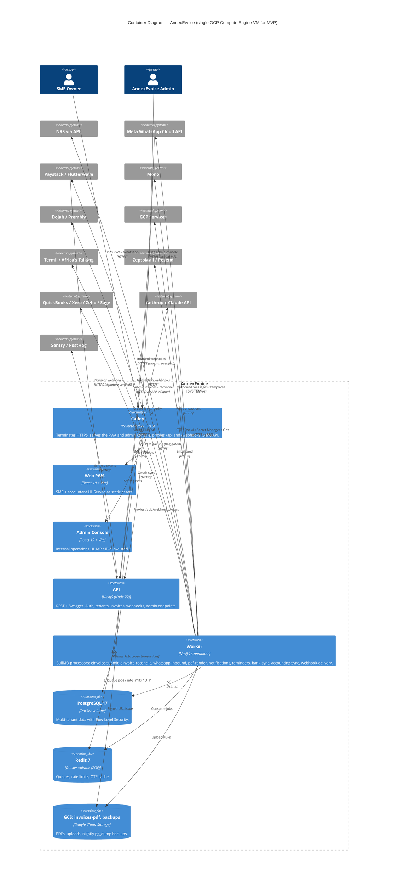

# C4 — Container Diagram

Inside the VM boundary, Caddy terminates TLS and serves the static frontends; the NestJS API owns all business logic; the worker runs BullMQ processors; Postgres and Redis provide durable state and queues. GCS holds PDFs and uploads. Every external service is reached through a provider adapter in the API or worker.

Every container that talks to an external system does so via its provider adapter (`EInvoiceProvider`, `MessagingProvider`, `PaymentProvider`, `BankFeedProvider`, `KycProvider`, `StorageProvider`, `AccountingProvider`, `SmsProvider`, `EmailProvider`, `LlmParsingProvider`), each with a `mock` and real implementation selected by env.
