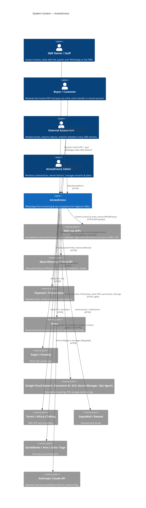

# C4 — System Context

AnnexEvoice sits between Nigerian SMEs and the NRS e-invoicing fabric. The SME owner talks to it through WhatsApp or a PWA. The platform transmits invoices to NRS through an accredited Access Point Provider, collects payments through Paystack/Flutterwave, delivers notifications through Meta's Cloud API, SMS and email, and syncs with accounting software the SME already uses.

## Boundaries

- **Inside AnnexEvoice**: API, worker, databases, static frontends, PDF renderer, mock providers.
- **Outside**: every third-party service above and both user groups.
- **Trust boundary**: every outbound call sits behind a provider adapter; raw provider payloads are never exposed to the client.
