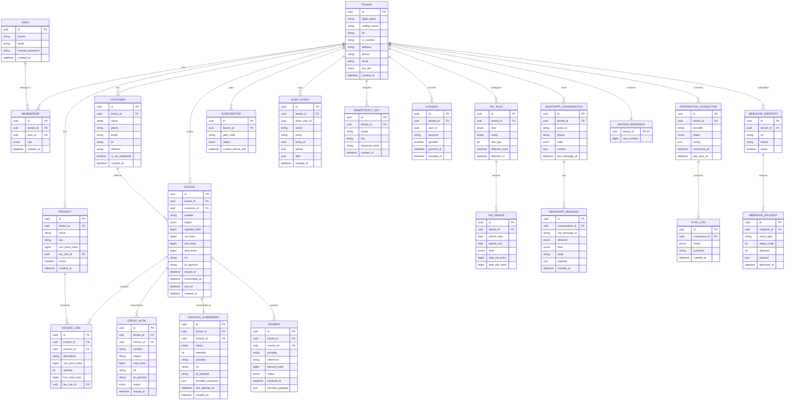

# ERD — AnnexEvoice

Every tenant-scoped row carries `tenant_id` and is protected by Row-Level Security. Money is stored as integer kobo. Rates are in basis points on `tax_rules`.

## Numbering
`invoice_sequences` holds `(tenant_id, next_number)` and is updated inside the same transaction that issues an invoice, with `SELECT ... FOR UPDATE` so numbers are gapless.

## Retention
`audit_events`, `einvoice_submissions` and `webhook_deliveries` are append-only and retained per the NRS/NDPA policy.
